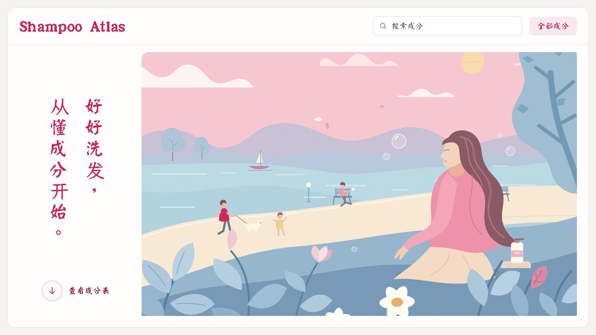

# Shampoo Atlas · 洗发水成分图鉴

认识洗发水里的每一块「配方积木」。按六大模块浏览 152 条成分资料，根据头皮、发质和当前状态，查看相关的推荐与避开成分。

React + Vite 构建的静态网站，无需后端。项目同时提供可独立运行的本地成分检索 skill。



## 功能

- **成分百科**：六大模块分组，统一展示中文名 / INCI、功能、适合人群、避开人群、配伍信息和资料来源。
- **即时筛选**：选择头皮、发质或当前状态后，自动切换为上方绿色推荐表、下方红色避开表；清空选择恢复总表。
- **成分搜索**：搜索中文名、INCI 与成分资料内容。
- **插画首页**：点击「查看成分表」平滑进入资料页，点击英文品牌返回首页并保留已选条件。
- **响应式布局**：桌面筛选栏与表格独立滚动，手机采用上下布局；支持键盘操作与减少动态效果偏好。
- **本地分析 skill**：为支持本地脚本的 AI 工具提供成分查库、个人避开项核对和多款产品比较。

## 六大模块

| 模块 | 内容 |
| --- | --- |
| 主表面活性剂 | 主要清洁成分 |
| 辅助／两性表面活性剂 | 与主表活配合的清洁成分 |
| 硅油与成膜聚合物 | 顺滑、成膜相关成分 |
| 阳离子调理剂、蛋白与保湿成分 | 发丝调理相关成分 |
| 头皮活性物与去屑成分 | 头皮护理相关成分 |
| 配方辅助成分 | 防腐剂、酸碱调节剂、螯合剂等 |

## 快速开始

需要 **Node.js 22.12+**，建议使用 Node.js 22。

```sh
git clone https://github.com/10522-x/shampoo-atlas.git
cd shampoo-atlas
npm ci
npm run dev
```

打开 [http://127.0.0.1:5173/](http://127.0.0.1:5173/)。

| 命令 | 用途 |
| --- | --- |
| `npm run dev` | 启动开发服务器 |
| `npm test` | 验证成分数据、匹配规则及 skill 一致性 |
| `npm run build` | 生成生产文件到 `dist/` |
| `npm run preview` | 在本地预览生产构建，默认端口 4173 |
| `npm run skill:sync` | 从网站数据和规则同步 skill 快照 |
| `npm run skill:benchmark` | 测量本地查库耗时 |

## 部署到 Netlify

关联此 GitHub 仓库，部署分支选择 `main`。根目录的 [netlify.toml](netlify.toml) 已包含：

| 设置 | 值 |
| --- | --- |
| Node.js | `22` |
| 构建命令 | `npm run build` |
| 发布目录 | `dist` |

手动部署时，运行 `npm ci` 和 `npm run build`，再将生成的 `dist/` 文件夹上传到 Netlify。发布目录的根层应包含 `index.html`、`assets/`、`fonts/` 和 `illustrations/`。

若出现模块 MIME 错误并伴随字体 404，请检查发布目录：生产首页应加载 `/assets/*.js`，字体位于 `/fonts/`。源码目录中的 JSX 需要先经过 Vite 构建。

## 项目结构

```text
src/
  components/       首页、筛选栏与成分表
  data/             152 条成分、六模块、选项定义
  lib/matching.js   人群匹配与排序
  App.jsx           页面状态与搜索
  styles.css        页面样式
public/
  fonts/            本地字体及各自许可
  illustrations/    首页原创 SVG 插画
font-sources/       王漢宗字体原始输入与子集构建说明
skills/             可携带的 shampoo-advisor skill
scripts/            skill 同步与基准脚本
test/               数据及行为验证
releases/           skill ZIP 与验证记录
design-references/  设计参考和来源记录
netlify.toml        Netlify 构建设置
```

[AGENTS.md](AGENTS.md) 记录已确认的产品规则，[DESIGN.md](DESIGN.md) 记录视觉约定。

## 数据与匹配方式

数据源为 [ai_studio_code.txt](ai_studio_code.txt)，[src/data/ingredients.json](src/data/ingredients.json) 保留其 152 条单成分记录。模块内顺序为编辑整理，未宣称依据市场频次统计。

当前匹配依据原始 `best` / `avoid` 人群标签：

- 同一个标签中的多个明确条件需要同时满足。
- 推荐与避开冲突时，优先归入避开。
- 未命中、中性或信息不足的成分不强制归入两张定制表；结果允许为空。
- `func` / `synergy` 原文继续展示，目前不参与匹配计算。

这是单成分资料与人群标签的匹配工具，不是洗发水产品评分器。完整配方的多成分作用、浓度、pH 与个人过敏史等尚未纳入；原始文献也尚未逐条核验。用户选择保存在当前页面内存中，无需注册或提交到后端。

## AI 成分分析 skill

[skills/shampoo-advisor/](skills/shampoo-advisor/) 包含同源数据库、名称索引和匹配规则快照。AI 读取用户提供的照片或文字后，由本地 Node.js 脚本检索；网站本身未提供上传照片或调用 AI 的服务。

脚本只需 **Node.js 18+**，无需安装 npm 依赖、API key 或联网查询：

```sh
# 按成分名查库
node skills/shampoo-advisor/scripts/analyze.mjs --lookup "水杨酸" --pretty

# 分析自备的输入文件，格式见 skill 文档
node skills/shampoo-advisor/scripts/analyze.mjs --input input.json --pretty
```

完整输入格式和工作流见 [SKILL.md](skills/shampoo-advisor/SKILL.md) 与 [输入输出说明](skills/shampoo-advisor/references/input-output.md)。

在支持本地技能的 AI 工具中，可将 [shampoo-advisor.zip](releases/shampoo-advisor.zip) 解压到其技能目录。Codex 用户目录为 `~/.agents/skills/`，解压后应得到 `~/.agents/skills/shampoo-advisor/SKILL.md`。重新打开聊天后选择该技能，或输入 `$shampoo-advisor`。

调用示例：

> 使用 $shampoo-advisor，我是油性头皮、细软发、染烫后容易毛躁，请结合成分表照片分析这瓶洗发水。

模糊名称只返回核对候选；未收录不等于不安全，单成分信号不能作为整瓶产品的确定结论。基准测试仅测本地查库，不含读图和模型生成。

## 参与贡献

欢迎通过 [Issues](https://github.com/10522-x/shampoo-atlas/issues) 提交问题、资料勘误或建议，也欢迎提交 Pull Request。成分修订请附可核对的出处；匹配逻辑修改请补充有意义的行为验证。

修改数据库、别名或匹配规则后，运行 `npm run skill:sync`、`npm test` 和 `npm run build`，并同步更新 skill 交付包。

## 开源许可

项目原创代码、文档、成分资料整理内容和首页 SVG 插画采用 [MIT License](LICENSE)。第三方字体保留 OFL-1.1 / GPL-2.0-or-later 许可；设计参考截图不在 MIT 授权范围内。各项来源及适用范围见 [THIRD_PARTY_NOTICES.md](THIRD_PARTY_NOTICES.md)。
